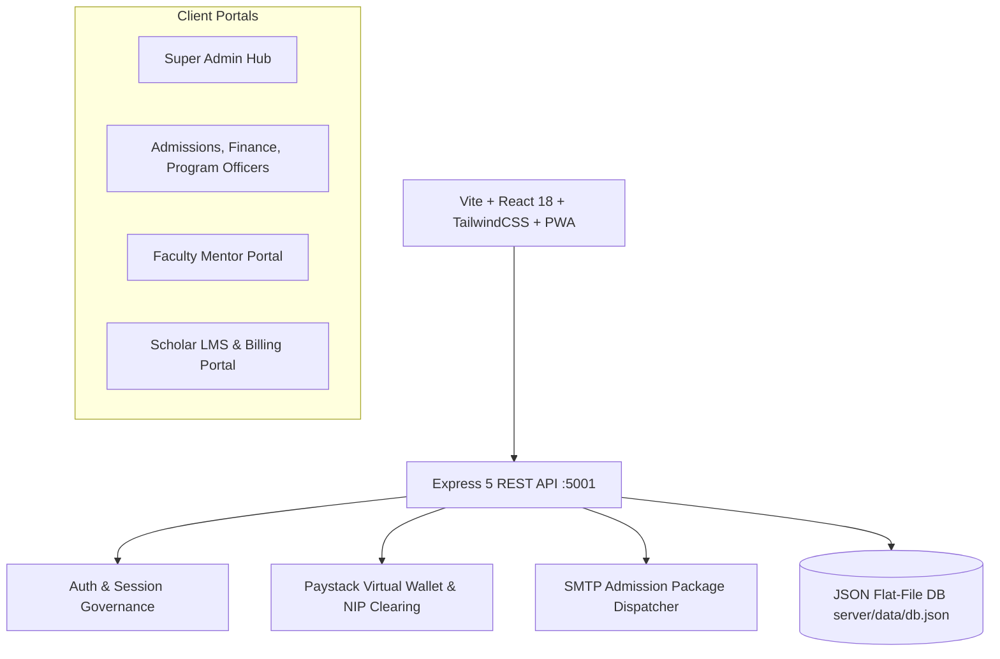

# 🎓 Educate CRM — Institutional Operations, LMS & Multi-Role Governance Suite

[](https://opensource.org/licenses/MIT)
[](https://nodejs.org)
[](https://react.dev)
[](https://www.typescriptlang.org)
[](https://tailwindcss.com)
[](https://expressjs.com)
[](https://recharts.org)

Educate CRM (Nexus Institute Suite) is an enterprise-grade full-stack Edu-Business Operations, Classroom LMS, and Multi-Role Governance CRM platform engineered for technology institutes, polytechnics, coding academies, and higher-education institutions.

The platform features strict **Nigerian Banking Standards** (CBN NUBAN 10-digit validation, 3-Tier Customer Due Diligence KYC), automated **Paystack Live Settlement & Virtual Wallet** clearing, **2-Tier Super Admin OpEx Approval**, complete **Classroom & LMS Video Progression**, multi-file **Support Tickets**, and dynamic **Role & Permission Architecture**.

---

## 📑 Table of Contents
1. [Core Architecture & Tech Stack](#-core-architecture--tech-stack)
2. [7 User Personas & Role Matrix](#-7-user-personas--role-matrix)
3. [11 Core Functional Modules](#-11-core-functional-modules)
4. [34 Modals Inventory](#-34-modals-inventory)
5. [Nigerian 3-Tier KYC & Banking Standards](#-nigerian-3-tier-kyc--banking-standards)
6. [Comprehensive REST API Reference (60+ Endpoints)](#-comprehensive-rest-api-reference-60-endpoints)
7. [Master QA Test Checklist & Verification Guide](#-master-qa-test-checklist--verification-guide)
8. [Local Development & Automated Testing](#-local-development--automated-testing)
9. [Production Deployment (Hostinger VPS CI/CD)](#-production-deployment-hostinger-vps-cicd)

---

## 🏛️ Core Architecture & Tech Stack



- **Frontend**: React 18, TypeScript, Vite, Tailwind CSS, Recharts, Lucide Icons, Google Material Symbols, Service Worker PWA with Web Push Notifications.
- **Backend**: Node.js 20 LTS, Express 5, TypeScript (`tsx`), Nodemailer, Web-Push, CORS.
- **Data Layer**: Structured atomic JSON database (`server/data/db.json`) with automated pre/post deployment snapshot safety locks.
- **Clearing & Payment Rails**: Paystack API (Balance query, dedicated virtual accounts, NIP instant bank transfers, Webhooks).

---

## 👥 7 User Personas & Role Matrix

| Persona / Role | System Code | Primary Landing | Primary Responsibilities & Access Bounds |
| :--- | :--- | :--- | :--- |
| **Super Admin** | `super_admin` | `/reports` | Managing Director & Chancellor. Full unrestricted authority. Exclusive right to approve OpEx expenses, override user passwords, toggle institution modules, modify staff records, and configure roles. |
| **Head of Admissions** | `admissions` | `/leads` | Leads pipeline management, student enrollment onboarding, default password generation, and admission letter dispatch. Can disburse funds **only after Super Admin approves**. |
| **Finance Controller** | `finance` | `/expenses` | Bursary and financial accounting. Tuition invoice reconciliation, payment proof verification, OpEx budget monitoring, and Paystack wallet management. |
| **Academic Program Officer** | `program_officer` | `/courses` | Curriculum design, cohort intake schedules, timetable class assignments, and faculty performance monitoring. |
| **Faculty Mentor** | `mentor` | `/mentors` | 1-on-1 coaching sessions, weekly office hours slot management, student assignment grading, student welfare reports, and payout requests (with 5% WHT deduction). Financial ledgers of students are masked. |
| **Student Scholar** | `student` | `/student/dashboard` | Personalized student dashboard, multimedia LMS classroom, lesson progression, assignment submissions, mentor booking, tuition invoicing, and Paystack checkout. Gated from all administrative modules. |
| **Custom Roles** | Dynamic ID | Dynamic | Dynamically created by Super Admin with customized module visibility and fine-grained capability switches. |

### Role Permissions & Capability Matrix

| Capability Flag | Super Admin | Admissions | Finance | Program Officer | Mentor | Student |
| :--- | :---: | :---: | :---: | :---: | :---: | :---: |
| `canAddCourses` / `canAddCohorts` | ✅ | ✅ | ❌ | ✅ | ❌ | ❌ |
| `canAddLeads` | ✅ | ✅ | ❌ | ❌ | ❌ | ❌ |
| `canEnrollStudents` | ✅ | ✅ | ❌ | ❌ | ❌ | ❌ |
| `canLogExpenses` | ✅ | ✅ | ✅ | ❌ | ❌ | ❌ |
| `canApproveExpenses` | ✅ (Sole) | ❌ | ❌ | ❌ | ❌ | ❌ |
| `canDisburseApprovedFunds` | ✅ | ✅ (If Approved) | ✅ (If Approved) | ❌ | ❌ | ❌ |
| `canIssueCertificates` | ✅ | ❌ | ❌ | ✅ | ❌ | ❌ |
| `canViewBilling` | ✅ | ✅ | ✅ | ❌ | ❌ | Own Only |
| `canManageSettings` | ✅ | ❌ | ❌ | ❌ | ❌ | ❌ |
| `canManageAttendance` | ✅ | ✅ | ❌ | ✅ | ❌ | ❌ |
| `canViewBiodata` | ✅ | ✅ | ✅ | ✅ | Assigned Only | Own Only |
| `canModifyStudentBiodata` | ✅ | ✅ | ❌ | ❌ | ❌ | ❌ |
| `canModifyMentorBiodata` | ✅ | ❌ | ❌ | ❌ | ❌ | ❌ |
| `canModifyStaffBiodata` | ✅ (Exclusive) | ❌ | ❌ | ❌ | ❌ | ❌ |

---

## 📦 11 Core Functional Modules

### 1. Executive Reports & Institutional Analytics (`/reports`)
- Comprehensive executive dashboard featuring Realized Tuition Revenue, Net Operating Cashflow, Active Students, and Lead Conversion metrics.
- Recharts visualizations: Revenue vs. OpEx burn trends, Lead acquisition funnels, Cohort completion percentages, and Faculty lecturing rankings.
- Multi-format data exporter (`ExportReportModal`) generating formatted CSV and JSON downloads.

### 2. Programs, Cohorts & Curriculum Architecture (`/courses`)
- Academic program catalog with course codes, duration, tuition pricing, and Google Drive curriculum links.
- Bulk course ingestion via CSV parser (`BulkUploadCoursesModal`).
- Intake cohort manager (Active, Upcoming, Completed) with designated faculty mentors.
- Timetable scheduling engine (`ScheduleClassModal`) with Google Meet and physical classroom allocation.

### 3. Leads Acquisition & Admissions Pipeline (`/leads`)
- Interactive Kanban pipeline (New, Discovery, Contacted, Qualified, Negotiation, Converted, Lost).
- Algorithmic lead scoring based on engagement frequency, channel source, and program fit.
- **1-Click Conversion to Student Scholar**: Provisions student record, issues tuition ledger, generates institutional default password, and dispatches admission package.

### 4. Student Enrollment, Onboarding & Academic Records (`/students`)
- Student registry with program, cohort, tuition payment status, and academic progress filters.
- **Onboarding Engine (`EnrollStudentModal`)**: Auto-generates default password (`Edu#XXXX!XX`), sets `mustResetPassword: true`, auto-populates Google Drive links for Student Handbook & Curriculum, and sends admission email.
- **Biodata Governance**: Role-governed editing (`EditStudentModal`) and complete 4-tab 3-Tier KYC inspection (`ViewBiodataModal`).
- **Graduation Gate**: Attendance-verified certificate issuance (`CertificateModal`) requiring minimum learning hours.

### 5. Faculty Mentors, Grading & Payout Settlement (`/mentors`)
- Faculty roster tracking lecturing hours, active mentees, and performance ratings.
- **Weekly Office Hours Scheduler (`/mentors/office-hours`)**: Open booking slots with Google Meet automation.
- **Grading Inbox (`/mentors/grading`)**: Assignment evaluation queue with scores, feedback, and pass/revision verdicts.
- **Course Outlines (`/mentors/course-outlines`)**: Standardized NBTE and NITDA tech curriculum tree.
- **Faculty Payout Requisition (`RequestPayoutModal`)**: Validates delivered lecture hours, auto-populates verified NUBAN details, deducts 5% statutory Withholding Tax (WHT), and renders printable vouchers (`PayoutVoucherModal`).

### 6. Staff Attendance & Geolocation Clocking (`/attendance`)
- Geofence-verified mobile & desktop Clock-In (`ClockInModal`) and Clock-Out (`ClockOutModal`).
- Real-time monthly staff and mentor attendance register.
- Classroom roll-call tool (`TakeAttendanceModal`) for scheduled lectures.

### 7. OpEx Expenses, 2-Tier Approval & Paystack Virtual Wallet (`/expenses`)
- Operating expense requisition logging (`LogExpenseModal`) with receipt attachment uploads.
- **2-Tier Approval Governance**: Non-superadmin users see disbursement locks; only Super Admin can approve/reject requisitions.
- **Institutional Wallet**: Live Paystack balance query, virtual top-up verification (`TopUpWalletModal`), and automated NIP settlement disbursement (`DisburseFundsModal`).

### 8. Student Scholar Portal (`/student/dashboard`, `/student/courses`, `/student/mentor`)
- **Dashboard**: Quick academic stats, timetable of upcoming lectures, mentor contact cards, and Google Drive links for Handbook & Curriculum.
- **Classroom & LMS**: Hierarchical syllabus modules, video lesson player, lesson completion tracker, and assignment submission portal with GitHub & live URL links.
- **Faculty Mentorship**: View assigned mentor, book office hours slots, and review past feedback.

### 9. Student Tuition, Invoicing & Billing (`/student/billing`)
- Real-time tuition breakdown, installment schedules, and invoice downloads (`InvoiceModal`).
- Paystack inline checkout gateway integration for instant tuition clearance.
- Manual bank transfer proof submission with teller / receipt proof attachment.

### 10. Universal Support & Feedback Tickets (`/tickets`)
- Accessible to all roles (Super Admin, Staff, Mentors, and Students).
- Ticket creation with categorization, priority, and multi-file attachments (images, PDFs, logs).
- Threaded conversation stream with full date & time stamps (`DD MMM YYYY, hh:mm A`) and downloadable attachment chips.
- Status workflow (Open -> In Progress -> Resolved -> Closed) with formal resolution notes.

### 11. Institutional Settings, Universal User Directory & 3-Tier KYC (`/settings`)
- **Universal User Directory & Governance (`?section=users`)**: Centralized roster across Staff, Mentors, and Students. Displays KYC compliance status (`Tier 1/2/3`, `✓ Cleared`, `○ In Review`, `● Incomplete`), View Biodata dossier trigger, administrative password override, and account deactivation switch.
- **3-Tier Nigerian KYC Self-Service (`?section=profile`)**: Civil demographics, NIN/Passport ID with proof upload, residential address with utility bill proof, Next of Kin, and NUBAN bank verification.
- **Roles & Permissions Architect (`?section=roles`)**: Dynamic custom role creation and granular capability switches.
- **Backup & Production Governance (`?section=backups`)**: JSON database export/restore, production data flush, and 10-module enablement toggles.

---

## 🪟 34 Modals Inventory

| Modal Component | Trigger / ModalType | Purpose | Primary Access Roles |
| :--- | :--- | :--- | :--- |
| `CreateRecordHubModal.tsx` | `'create-hub'` | Global quick-action creator for leads, students, courses, expenses | Staff, Super Admin |
| `AddLeadModal.tsx` | `'add-lead'` | Captures prospect lead details and channel source | Admissions, Super Admin |
| `EnrollStudentModal.tsx` | `'enroll-student'` | Onboards student with default password & Drive links | Admissions, Super Admin |
| `EditStudentModal.tsx` | `'edit-student'` | Modifies student biodata (name, phone, program, cohort) | `canModifyStudentBiodata`, Super Admin |
| `ViewBiodataModal.tsx` | `'view-biodata'` | Full 4-tab 3-Tier Nigerian KYC dossier with printable view | `canViewBiodata`, Super Admin |
| `RecruitMentorModal.tsx` | `'recruit-mentor'` | Adds new faculty mentor profile, expertise, and bank details | Super Admin |
| `EditMentorModal.tsx` | `'edit-mentor'` | Modifies faculty mentor details and lecturing capacity | `canModifyMentorBiodata`, Super Admin |
| `AssignMentorModal.tsx` | `'assign-mentor'` | Assigns or reassigns faculty mentor to a student scholar | Admissions, Super Admin |
| `BookSessionModal.tsx` | `'book-session'` | Schedules 1-on-1 coaching session with student | Mentors, Staff |
| `CreateCourseModal.tsx` | `'create-course'` | Defines academic program, tuition fee, and Drive curriculum URL | Program Officer, Super Admin |
| `EditCourseModal.tsx` | `'edit-course'` | Modifies course syllabus, fee, or curriculum Drive link | Program Officer, Super Admin |
| `BulkUploadCoursesModal.tsx` | `'bulk-upload-courses'` | Ingests bulk course list from structured CSV file | Program Officer, Super Admin |
| `CreateCohortModal.tsx` | `'create-cohort'` | Creates academic intake cohort and sets faculty mentor lead | Program Officer, Super Admin |
| `ScheduleClassModal.tsx` | `'schedule-class'` | Schedules lecture timetable slot with Google Meet link | Program Officer, Super Admin |
| `TakeAttendanceModal.tsx` | `'take-attendance'` | Takes student roll-call for a scheduled class | Mentors, Program Officer, Admin |
| `CourseOutlineModal.tsx` | `'course-outline'` | Displays standardized NBTE/NITDA syllabus outline | All Staff, Mentors, Admissions |
| `LogExpenseModal.tsx` | `'log-expense'` | Submits OpEx requisition with receipt attachment | Admissions, Finance, Super Admin |
| `ViewExpenseModal.tsx` | Page-mounted | 2-Tier approval inspection modal with Super Admin action buttons | Super Admin, Finance, Admissions |
| `RejectExpenseModal.tsx` | Page-mounted | Super Admin rejection dialog with mandatory reason note | Super Admin |
| `TopUpWalletModal.tsx` | `'top-up-wallet'` | Generates Paystack virtual account / card funding prompt | Finance, Super Admin |
| `DisburseFundsModal.tsx` | `'disburse-expense'`, `'disburse-mentor'` | Executes Paystack NIP bank disbursement for approved funds | `canDisburseApprovedFunds`, Super Admin |
| `WalletTransactionDetailsModal.tsx` | Page-mounted | Inspects Paystack settlement transaction reference and receipt | Finance, Super Admin |
| `RequestPayoutModal.tsx` | `'request-payout'` | Mentor submits payout with automatic 5% WHT calculation | Mentors |
| `PayoutVoucherModal.tsx` | Page-mounted | Generates official printable payout voucher | Mentors, Finance, Super Admin |
| `ClockInModal.tsx` | `'clock-in'` | Geofence-verified staff clock-in | Staff, Mentors |
| `ClockOutModal.tsx` | `'clock-out'` | Records departure timestamp and computes duty hours | Staff, Mentors |
| `CertificateModal.tsx` | `'view-certificate'` | Verifies hours and renders printable graduation certificate | Program Officer, Super Admin, Student |
| `InvoiceModal.tsx` | `'view-invoice'` | Displays formatted tuition invoice with installment ledger | Finance, Student, Super Admin |
| `ChangePasswordModal.tsx` | `'change-password'` | User self-service password update with strength meter | All Authenticated Users |
| `ResetUserPasswordModal.tsx` | `'reset-user-password'` | Super Admin administrative password override dialog | Super Admin (Exclusive) |
| `ExportReportModal.tsx` | `'export-report'` | Configures date range and downloads CSV/JSON executive report | Program Officer, Super Admin |
| `SubmitPerformanceReportModal.tsx` | `'submit-performance-report'` | Mentor files student progress and performance review | Mentors |
| `StudentWelfareInterventionModal.tsx` | Page-mounted | Flags welfare risk and requests academic intervention | Mentors, Program Officer |
| `TransferTasksAndDeleteModal.tsx` | Page-mounted | Reassigns active mentees and tasks before deleting a mentor | Super Admin |

---

## 🇳🇬 Nigerian 3-Tier KYC & Banking Standards

The platform strictly implements Central Bank of Nigeria (CBN) Customer Due Diligence (CDD) and Nigerian Uniform Bank Account Number (NUBAN) standards:

1. **Tier 1 (Civil Demographics)**: Official passport photo, full legal name, Date of Birth (DOB), gender, nationality, state of origin (36 States + FCT), and Local Government Area (LGA).
2. **Tier 2 (Government Identification)**: Verified NIN (11 digits), BVN (11 digits), International Passport, Driver's License, or Voter's Card (PVC) + scanned document upload.
3. **Tier 3 (Proof of Address & Guarantor)**: Residential street address, verifiable utility bill proof (EKEDC/IBEDC/receipt/tenancy agreement), and Next of Kin emergency guarantor details.
4. **Settlement Bank (NUBAN)**: Validated 10-digit NUBAN checked against CBN clearing sort codes for seamless Paystack and NIP disbursements.

---

## 📡 Comprehensive REST API Reference (60+ Endpoints)

### Core System & Health
- `GET /api/health` — Public server uptime & version check.
- `GET /api/bootstrap` — Unified bootstrap of all institutional datasets.
- `POST /api/reset` — Restores demo seed dataset.
- `GET /api/backups/export` — Exports full database JSON backup.
- `POST /api/backups/restore` — Restores database from uploaded JSON backup.
- `POST /api/production/flush-demo-data` — Clears all demo records for live deployment.

### Authentication & Users
- `POST /api/auth/login` — User authentication with role-based profile return.
- `POST /api/auth/reset-password` — Self-service password reset.
- `POST /api/auth/send-welcome` — Dispatches onboarding email credentials.
- `GET /api/staff` — Lists all staff user accounts.
- `POST /api/staff` — Creates a new staff user.
- `PATCH /api/staff/:id` — Updates staff user role, department, or approver status.
- `DELETE /api/staff/:id` — Deletes staff member.
- `PATCH /api/users/:id/status` — Toggles active/deactivated login status.
- `POST /api/users/:id/reset-password` — Super Admin administrative password override.
- `POST /api/users/:id/transfer-and-delete` — Transfers tasks before account deletion.
- `GET /api/roles` — Lists built-in and custom roles.
- `POST /api/roles` — Creates a custom role definition.
- `PATCH /api/roles/:id` — Updates custom role permissions and module access.

### Leads & Student Scholars
- `GET /api/leads` — Lists prospect pipeline leads.
- `POST /api/leads` — Creates a new prospect lead.
- `PATCH /api/leads/:id` — Updates lead stage, score, or notes.
- `POST /api/leads/:id/convert` — Converts lead to enrolled student scholar.
- `GET /api/students` — Lists enrolled students with academic progress.
- `POST /api/students` — Manually enrolls student with default password.
- `PATCH /api/students/:id` — Updates student biodata and course enrollment.
- `POST /api/students/:id/payment-reminder` — Dispatches tuition reminder email.
- `POST /api/students/:id/issue-certificate` — Issues graduation certificate.
- `POST /api/students/:id/proof-of-payment` — Submits manual bank transfer proof.

### Faculty Mentors & Payouts
- `GET /api/mentors` — Lists faculty mentor roster.
- `POST /api/mentors` — Recruits a new faculty mentor.
- `PATCH /api/mentors/:id` — Updates mentor capacity, expertise, and bank account.
- `DELETE /api/mentors/:id` — Removes mentor.
- `GET /api/payout-requests` — Lists mentor payout requests.
- `POST /api/payout-requests` — Submits payout request with 5% WHT deduction.
- `PATCH /api/payout-requests/:id` — Approves, disburses, or rejects payout request.
- `POST /api/reports/mentor-student` — Submits student performance evaluation.

### Academic Programs & Timetables
- `GET /api/courses` — Lists academic programs and Drive curriculum links.
- `POST /api/courses` — Adds new program.
- `PATCH /api/courses/:id` — Updates course fee or curriculum URL.
- `GET /api/cohorts` — Lists intake cohorts.
- `POST /api/cohorts` — Creates new cohort.
- `GET /api/timetables` — Lists scheduled classes.
- `POST /api/timetables` — Schedules a lecture slot.
- `PATCH /api/timetables/:id` — Updates timetable details.
- `DELETE /api/timetables/:id` — Removes timetable slot.
- `POST /api/timetables/:id/attendance` — Records class attendance.

### Expenses & Paystack Wallet
- `GET /api/expenses` — Lists operating expense requisitions.
- `POST /api/expenses` — Logs an expense requisition.
- `PATCH /api/expenses/:id` — Approves, rejects, or updates requisition status.
- `GET /api/wallet/summary` — Retrieves wallet balance and budget limits.
- `GET /api/wallet/paystack-balance` — Fetches real-time live Paystack balance.
- `POST /api/wallet/virtual-account` — Generates virtual account funding details.
- `POST /api/wallet/topup/verify` — Verifies card/bank top-up transaction.
- `POST /api/wallet/disburse-expense` — Executes Paystack NIP bank settlement for approved expense.
- `POST /api/paystack/disburse-mentor` — Executes Paystack NIP transfer for mentor payout.
- `POST /api/paystack/webhook` — Paystack transfer & charge webhook listener.

### Classroom LMS
- `GET /api/lms/modules` — Lists course syllabus modules and lessons.
- `POST /api/lms/modules` — Creates syllabus module.
- `POST /api/lms/lessons/:lessonId/complete` — Student marks lesson complete.
- `GET /api/lms/assignments` — Lists assignment submissions.
- `POST /api/lms/assignments/submit` — Submits student project repository & notes.
- `POST /api/lms/assignments/:id/grade` — Mentor submits grade, feedback, and score.

### Support Tickets & Notifications
- `GET /api/tickets` — Lists support tickets.
- `POST /api/tickets` — Creates ticket with multi-file attachments.
- `PATCH /api/tickets/:id` — Updates ticket status or assigns agent.
- `POST /api/tickets/:id/comments` — Adds response comment with attachments.
- `GET /api/notifications` — Fetches notification stream.
- `PATCH /api/notifications/:id/read` — Marks notification as read.
- `POST /api/notifications/mark-all-read` — Marks all notifications read.
- `POST /api/push/subscribe` — Subscribes browser to Web Push notifications.

---

## 🧪 Master QA Test Checklist & Verification Guide

### 1. Authentication, Sessions & Password Reset
- [ ] **QA-AUTH-001**: Verify login across all 6 roles with correct landing routes.
- [ ] **QA-AUTH-002**: Verify that invalid password or non-existent email displays an error toast.
- [ ] **QA-AUTH-003**: Verify route guards: navigating directly to `/reports` as a Student redirects to `/`.
- [ ] **QA-AUTH-004**: Verify student onboarding default password (`Edu#XXXX!XX`) displays password reset banner on Student Dashboard.
- [ ] **QA-AUTH-005**: Verify changing password via `ChangePasswordModal` clears `mustResetPassword: false` and dismisses banner.
- [ ] **QA-AUTH-006**: Verify Super Admin can administratively override any user's password in `/settings?section=users`.

### 2. Executive Reports & Analytics
- [ ] **QA-REP-001**: Verify KPI metrics (Revenue, Active Students, Payouts) match database sums.
- [ ] **QA-REP-002**: Verify Recharts financial trends render without console errors.
- [ ] **QA-REP-003**: Verify `ExportReportModal` generates clean, downloadable CSV data.

### 3. Programs, Cohorts & Curriculum Google Drive Integration
- [ ] **QA-CRS-001**: Verify creating a course with a Google Drive curriculum link saves and persists.
- [ ] **QA-CRS-002**: Verify bulk uploading courses via CSV populates courses table accurately.
- [ ] **QA-CRS-003**: Verify creating a cohort assigns the designated faculty mentor.
- [ ] **QA-CRS-004**: Verify class scheduling renders Google Meet links on student dashboard.

### 4. Leads Pipeline & Conversion
- [ ] **QA-LED-001**: Verify adding a lead calculates lead score.
- [ ] **QA-LED-002**: Verify moving lead across Kanban stages updates activity log.
- [ ] **QA-LED-003**: Verify "Convert to Student" atomically provisions student, calculates invoice, generates default password, and sends admission email with Drive links.

### 5. Student Enrollment, Biodata & Certificates
- [ ] **QA-STU-001**: Verify manual enrollment generates student ID, default password, and displays copy credentials card.
- [ ] **QA-STU-002**: Verify Admissions with `canModifyStudentBiodata` can edit student biodata; unauthorized roles have edit hidden.
- [ ] **QA-STU-003**: Verify "View Biodata" displays 4-tab 3-Tier KYC dossier with print support.
- [ ] **QA-STU-004**: Verify graduation certificate is locked if student has `< 40` learning hours; unlocks when hours `>= 40`.

### 6. Mentors, Grading & 5% WHT Payouts
- [ ] **QA-MNT-001**: Verify recruiting mentor saves expertise and NUBAN bank account.
- [ ] **QA-MNT-002**: Verify mentor office hours slot creation appears on student booking calendar.
- [ ] **QA-MNT-003**: Verify mentor grading inbox updates assignment score and student progress.
- [ ] **QA-MNT-004**: Verify mentor payout request auto-populates NUBAN, checks minimum hours, and deducts 5% WHT.
- [ ] **QA-MNT-005**: Verify payout voucher generates printable document with CBN sort code and WHT breakdown.

### 7. Staff Attendance & Geolocation
- [ ] **QA-ATT-001**: Verify clock-in requests geolocation permission and validates campus boundary.
- [ ] **QA-ATT-002**: Verify clock-out records departure timestamp and calculates duty hours.
- [ ] **QA-ATT-003**: Verify class roll-call updates individual student attendance rates.

### 8. OpEx Expenses, 2-Tier Approval & Paystack Disbursement
- [ ] **QA-EXP-001**: Verify logging expense sets status `Pending Approval` with disbursement locked.
- [ ] **QA-EXP-002**: Verify Admissions cannot approve expense; Super Admin sees Approve and Reject buttons.
- [ ] **QA-EXP-003**: Verify approving expense unlocks "Disburse Approved Funds" button for authorized disbursers (`canDisburseApprovedFunds`).
- [ ] **QA-EXP-004**: Verify disbursement deducts Paystack wallet balance and creates NIP reference.
- [ ] **QA-EXP-005**: Verify direct API disbursement of non-approved expense fails with HTTP 400.

### 9. Student Portal (Dashboard, LMS, Billing)
- [ ] **QA-STP-001**: Verify Student Dashboard renders Google Drive buttons for Curriculum & Handbook.
- [ ] **QA-STP-002**: Verify marking lesson complete increments course progress percentage.
- [ ] **QA-STP-003**: Verify submitting assignment sends project URLs to faculty grading inbox.
- [ ] **QA-STP-004**: Verify submitting manual bank transfer proof marks tuition invoice "Pending Verification".

### 10. Universal Support Tickets
- [ ] **QA-TCK-001**: Verify creating ticket supports multi-file attachments (images, PDFs, logs).
- [ ] **QA-TCK-002**: Verify conversation thread renders full timestamps (`DD MMM YYYY, hh:mm A`).
- [ ] **QA-TCK-003**: Verify replying with an attachment renders clickable download chip.
- [ ] **QA-TCK-004**: Verify resolving ticket records formal resolution notes.

### 11. Institutional Settings, Universal User Directory & 3-Tier KYC
- [ ] **QA-SET-001**: Verify Universal User Directory (`/settings?section=users`) is accessible to Super Admin and users with `canViewBiodata`.
- [ ] **QA-SET-002**: Verify KYC Compliance column displays tier badges (`Tier 1/2/3`) and status (`✓ Cleared`, `○ In Review`, `● Incomplete`).
- [ ] **QA-SET-003**: Verify role modification boundaries: Super Admin can edit all; assigned roles can only edit students/mentors; staff editing is locked to Super Admin.
- [ ] **QA-SET-004**: Verify deactivating an account blocks subsequent login attempts.
- [ ] **QA-SET-005**: Verify toggling off a module in `/settings?section=backups` hides it from sidebar and route guards.

---

## 💻 Local Development & Automated Testing

### Prerequisites
- Node.js 20 LTS or higher
- npm 9 or 10

### Setup
```bash
# Clone the repository
git clone https://github.com/eskay243/educate-crm.git
cd educate-crm

# Install dependencies
npm install

# Start Full-Stack App (Vite :5173 + Express :5001)
npm run dev:full

# Or start frontend and backend in separate terminals:
npm run server  # Terminal 1: Backend Express API (:5001)
npm run dev     # Terminal 2: Frontend Vite (:5173)
```

### Running the Automated QA Regression Suite
```bash
# Execute the full automated API regression test suite
npx tsx scripts/qa-api-test-suite.ts

# Run production build and TypeScript compilation check
npm run build
```

---

## 🚀 Production Deployment (Hostinger VPS CI/CD)

The repository is equipped with fully automated continuous deployment via GitHub Actions:
- **Production Server**: Hostinger Ubuntu VPS (`72.61.106.87`)
- **Live URL**: [https://growpot.cloud](https://growpot.cloud)
- **CI/CD Workflow**: [`.github/workflows/deploy.yml`](.github/workflows/deploy.yml)
- **Deployment Process**:
  1. Automated TypeScript compilation check (`npm run build`).
  2. Zero-downtime SSH deployment.
  3. Pre-deploy database backup preservation (`db.json` safety lock).
  4. PM2 process reload (`nexus-crm-api`) and Nginx reload.
