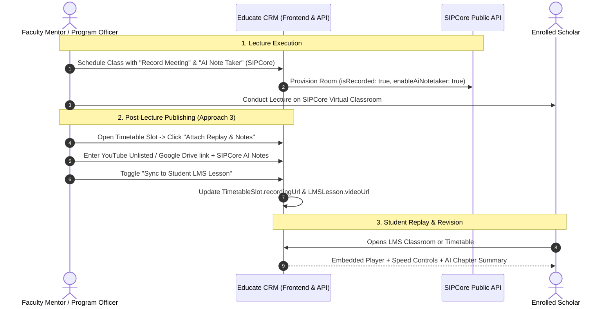

# 🎥 Approach 3 Implementation Plan: Streamlined Video Vault & AI Study Archive

This plan outlines the implementation of **Approach 3** for Educate CRM: combining **External Cloud Streaming Embeds (YouTube Unlisted, Google Drive, Loom, Vimeo)** with **SIPCore AI Note Taker Summaries**.

---

## 💡 Why Approach 3 is Ideal for Educate CRM

1. **Zero VPS Disk Overhead & Zero Bandwidth Bottlenecks**:
   - High-definition video never passes through or clogs the Hostinger VPS disk (`72.61.106.87`).
   - The production server remains lightning-fast, dedicated to CRM queries and database operations.
2. **Adaptive Bitrate Streaming for Nigerian Network Conditions**:
   - YouTube and Google Drive automatically adapt video resolution (1080p, 720p, 480p, 360p) based on the student's mobile connection, preventing buffering on 3G/4G networks.
3. **Dual Learning Experience**:
   - **Video Learners**: Watch the interactive embedded replay directly in the LMS.
   - **Low-Data / Quick Revision Learners**: Read the high-yield **SIPCore AI Note Taker summary** (key takeaways, action items, timestamped chapters) in 2 minutes without spending cellular data on video streaming!

---

## 🏗️ Architecture & Replay Lifecycle



---

## 📦 Proposed File Changes & Tasks

### 1. Data Schema Updates (`src/types/crm.ts`)
#### [MODIFY] `src/types/crm.ts`
- Extend `TimetableSlot`:
  ```typescript
  recordingUrl?: string; // YouTube, Google Drive, Loom, or SIPCore streaming link
  recordingPlatform?: 'youtube' | 'google_drive' | 'vimeo' | 'loom' | 'sipcore' | 'custom';
  recordingNotes?: string;
  aiTranscriptSummary?: {
    overview?: string;
    keyPoints?: string[];
    actionItems?: string[];
    chapters?: { time: string; title: string }[];
  };
  syncedToLmsLessonId?: string;
  ```
- Extend `LMSLesson`:
  ```typescript
  recordingSlotId?: string;
  recordingDate?: string;
  aiSummaryMarkdown?: string;
  ```

---

### 2. Backend Persistence (`server/server.ts`)
#### [MODIFY] `server/server.ts`
- Add `PATCH /api/timetables/:id/recording`:
  - Updates `recordingUrl`, `recordingPlatform`, and `aiTranscriptSummary` on the slot.
  - If `syncToLmsLesson: true` is supplied, locates the matching course/lesson in `db.lmsModules` and auto-populates `lesson.videoUrl` with the sanitized embed URL.
- Helper `formatVideoEmbedUrl(url: string)`:
  - Automatically transforms standard URLs to responsive embed links:
    - YouTube (`watch?v=ID` or `youtu.be/ID` → `https://www.youtube.com/embed/ID`)
    - Google Drive (`file/d/ID/view` → `https://drive.google.com/file/d/ID/preview`)
    - Loom (`loom.com/share/ID` → `https://www.loom.com/embed/ID`)
    - Vimeo (`vimeo.com/ID` → `https://player.vimeo.com/video/ID`)

---

### 3. Faculty & Coordinator Replay Publishing Modal
#### [NEW] `src/components/modals/AttachRecordingModal.tsx`
- Interactive modal triggered from Timetable slot cards:
  - **Replay Video Link Input**: Auto-detects platform (YouTube, Google Drive, Loom, Vimeo, etc.).
  - **Live Video Preview**: Instant embedded player to confirm the link works before publishing.
  - **SIPCore AI Note Taker Summaries**:
    - "Fetch from SIPCore" button (retrieves AI summary if available).
    - Or editable markdown field for Key Concepts, Action Items, and Topic Chapters.
  - **1-Click Sync**: Checkbox `[x] Automatically publish this recording to Course LMS Lesson`.

---

### 4. Timetable Cards Upgrade (`src/pages/CoursesCohortsPage.tsx` & `MentorSchedulePage.tsx`)
#### [MODIFY] `src/pages/CoursesCohortsPage.tsx`
- On each Timetable slot card:
  - If `slot.recordingUrl` exists:
    - Display a prominent **"Watch Replay"** button with a play icon.
    - Display an **"AI Study Notes"** badge.
  - In slot actions: Add an **"Attach Replay"** / **"Edit Recording"** button for coordinators and mentors.
#### [MODIFY] `src/pages/mentor/MentorSchedulePage.tsx`
- Allow faculty mentors to attach or update their class recordings right from their personal teaching calendar.

---

### 5. Student Learning Experience (`src/pages/student/StudentCoursesPage.tsx`)
#### [MODIFY] `src/pages/student/StudentCoursesPage.tsx`
- In the **Structured LMS Classroom**:
  - The video player seamlessly streams the lecture recording (YouTube, Drive, Loom, etc.) without leaving the CRM.
  - Adds an **"AI Lecture Summary & Key Takeaways"** section beneath the player.
  - In the **Cohort Timetable modal**:
    - Past lectures that have been taught now show a **"Watch Replay"** pill instead of a dead "Join Live" link.

---

## 📋 Step-by-Step Task Breakdown

### Task 1: Type Definitions (`src/types/crm.ts`)
- Update `TimetableSlot` and `LMSLesson` with recording fields, platform type, and AI summary structures.
- *Verification*: `npm run build` type-check passes.

### Task 2: Backend URL Transformer & Sync Endpoint (`server/server.ts`)
- Implement `formatVideoEmbedUrl` to handle YouTube, Google Drive, Loom, and Vimeo embed formats.
- Add `PATCH /api/timetables/:id/recording` with automatic LMS syllabus sync.
- *Verification*: Test API call with sample YouTube and Google Drive links.

### Task 3: `AttachRecordingModal.tsx` Component
- Build the modal with URL validator, embed preview, AI notes editor, and LMS sync checkbox.
- *Verification*: Component mounts without errors; preview loads iframe cleanly.

### Task 4: Integrate into Faculty & Coordinator Pages
- Wire `AttachRecordingModal` into `CoursesCohortsPage.tsx` and `MentorSchedulePage.tsx`.
- Update slot card UI to show "Watch Replay" and "AI Notes" badges.
- *Verification*: Replay button opens video modal or new tab smoothly.

### Task 5: Enhance Student LMS & Timetable Replays
- In `StudentCoursesPage.tsx`, render the embedded player and AI notes under the lecture content tab.
- In the student's timetable popup, display active "Watch Replay" buttons for completed classes.
- *Verification*: Log in as student demo and verify playback and AI summary view.

### Task 6: Final Audit & Pre-Deployment Snapshot
- Run `npm run build` locally to guarantee 0 build or lint errors.
- Run `node scripts/backup-and-log.js` to create an immutable database snapshot in `RESTORATION_LOG.md`.
