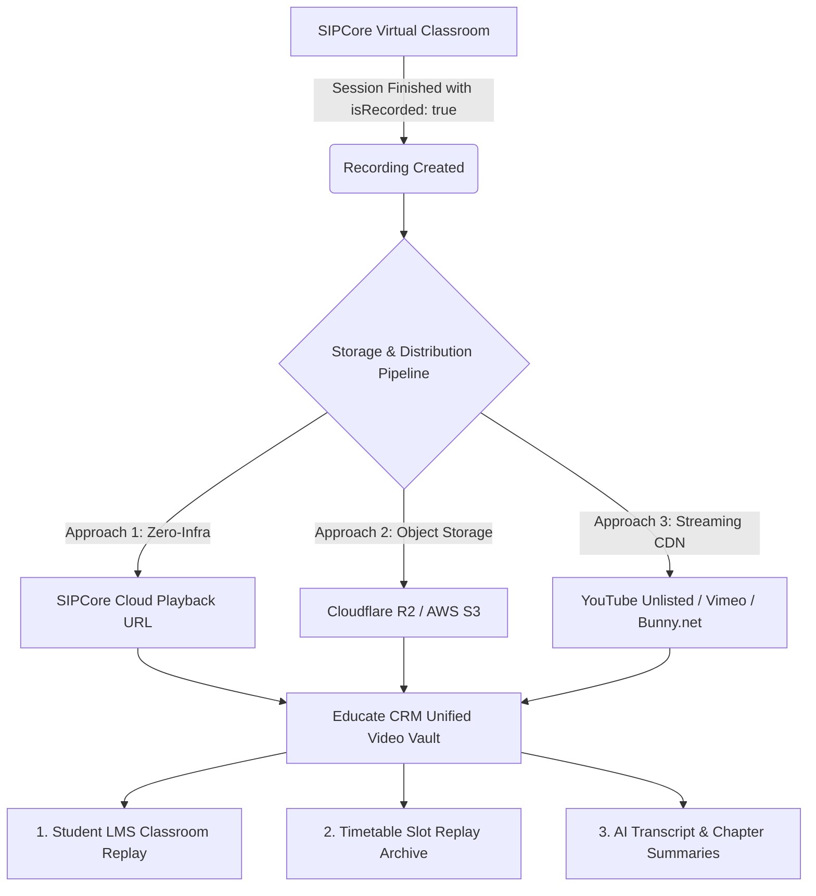

# 🎥 Meeting Recording, Cloud Storage & Student Replay Architecture Plan

This document defines the technical architecture, storage strategies, and rollout plan for recording virtual classroom lectures and 1-on-1 coaching sessions so that enrolled scholars can reference, re-watch, and study them at any time.

---

## 1. Executive Summary & Problem Analysis

In modern hybrid education, **video recording is high-bandwidth, high-storage, and latency-sensitive**:
- A single 2-hour lecture at 1080p/720p produces approximately **600MB to 1.5GB** of raw video.
- For 5 cohorts running 3 classes weekly, the system produces **~15GB to 25GB per week** (~100GB/month).
- **Critical Guardrail**: Storing raw video files directly on the Hostinger production VPS (`72.61.106.87`) will exhaust disk space, degrade PM2 API responsiveness, and risk database corruption.

Therefore, our recording and storage strategy must decouple **meeting capture**, **video storage**, and **student delivery**, while integrating seamlessly into the CRM's **Classroom LMS** and **Timetable Archives**.

---

## 2. Evaluation of Technical Approaches



### Approach 1: SIPCore Native Playback URL (Zero-Infra, Instant Availability)
* **How it works**:
  When `isRecorded: true` is passed at meeting creation, SIPCore records the WebRTC media conference on its server farm. Once finalized, the meeting record exposes a streaming `playbackUrl` / `recordingUrl`.
* **Pros**: Zero storage cost for Educate CRM, zero server disk usage, instant availability.
* **Cons**: Subject to SIPCore's retention policy (if `autoDeleteAfterEnd` is true or if meetings are purged after 30-90 days).

### Approach 2: Cloudflare R2 / AWS S3 Object Storage (Permanent, Lowest Cost)
* **How it works**:
  A background worker transfers completed recordings from SIPCore to an S3-compatible bucket (e.g. **Cloudflare R2**, which has **$0 egress fees** and costs only $0.015/GB/month).
* **Pros**: 100% data ownership, permanent retention, zero VPS disk consumption, predictable low cost ($1.50/month for 100GB).
* **Cons**: Requires configuring S3/R2 API keys in Settings.

### Approach 3: YouTube Unlisted / Google Drive / Vimeo Embedding (Faculty Workflow)
* **How it works**:
  Mentors or program officers can optionally attach an external link (such as an unlisted YouTube lecture or Google Drive recording) to any timetable class or LMS lesson.
* **Pros**: Zero cost, globally optimized adaptive streaming (works on 3G/4G networks in Nigeria with auto-resolution downscaling).
* **Cons**: Manual step for faculty if not automated.

---

## 3. Recommended Approach: The Hybrid "Smart Video Vault"

We recommend a **3-Tier Hybrid Pipeline**:

| Tier | Layer | Storage Location | Retention | Student Experience |
| :--- | :--- | :--- | :--- | :--- |
| **Tier 1** | **Active Replay** | SIPCore Cloud Playback / Direct Stream | 0–60 Days | Instant 1-click replay directly from Timetable & LMS cards |
| **Tier 2** | **LMS Permanent Archive** | Cloudflare R2 / Google Drive / YouTube | Permanent | Embedded in Student LMS Lesson (`LMSLesson.videoUrl`) |
| **Tier 3** | **Text AI Summary** | Database (`server/data/db.json`) | Permanent | 2-minute high-yield AI summary & transcript from SIPCore AI Note Taker |

---

## 4. End-to-End User Experience

### A. For Students (In `StudentCoursesPage.tsx`)
1. **Interactive Video Replay Tab**:
   In the Structured LMS Classroom, each lesson displays:
   - Embedded video player (responsive 16:9).
   - "Watch Lecture Recording" button with duration and date recorded.
   - Speed controls (0.75x, 1x, 1.25x, 1.5x, 2x).
2. **AI Executive Summary & Chapters**:
   Right below the video, students see the **SIPCore AI Note Taker** breakdown:
   - **Key Concepts Covered** (bullet points).
   - **Faculty Advice & Homework Tasks**.
   - **Timestamped Topic Chapters** (e.g., `00:15:00` - Setting up PostgreSQL).
   - **Full Downloadable Transcript** (PDF/TXT).
3. **Cohort Timetable Past Replays**:
   In the Timetable modal, completed past lectures show a green **"Watch Replay"** button with a play icon instead of "Join Live".

### B. For Faculty Mentors & Program Officers
1. **Automated Recording Trigger**:
   When scheduling via `ScheduleClassModal`, the "Record Meeting" toggle is available.
2. **Post-Class Recording Link Attachment**:
   When marking class attendance in `TimetableAttendanceModal` or `MentorCurriculumPage`, mentors can:
   - Confirm the automated SIPCore recording link.
   - OR paste an external backup recording URL (e.g. YouTube Unlisted or Google Drive).
   - Click **"Publish to Student LMS"**, which automatically binds the recording to the syllabus lesson.

---

## 5. Technical Data Model Changes

### 1. Update `TimetableSlot` in `src/types/crm.ts`:
```typescript
export interface TimetableSlot {
  // Existing fields...
  recordingUrl?: string; // Streaming playback URL
  recordingDownloadUrl?: string; // Direct MP4 download
  recordingDurationMinutes?: number;
  recordingStatus?: 'Processing' | 'Available' | 'Failed' | 'None';
  aiTranscriptSummary?: {
    overview: string;
    keyTakeaways: string[];
    chapters?: { timestamp: string; title: string }[];
    fullTranscriptUrl?: string;
  };
}
```

### 2. Update `LMSLesson` in `src/types/crm.ts`:
```typescript
export interface LMSLesson {
  // Existing fields...
  videoUrl?: string; // Used by LMS video player
  recordingSource?: 'sipcore' | 'youtube' | 'google_drive' | 'vimeo' | 'custom';
  recordedAt?: string;
  recordedByMentorName?: string;
  aiNotesMarkdown?: string;
}
```

### 3. Update `OrganizationSettings` in `src/types/crm.ts`:
```typescript
export interface StorageSettings {
  provider: 'sipcore_native' | 'cloudflare_r2' | 'aws_s3' | 'google_drive';
  r2AccountId?: string;
  r2AccessKeyId?: string;
  r2SecretAccessKey?: string;
  r2BucketName?: string;
  r2PublicDomain?: string;
  autoArchiveToR2: boolean;
}
```

---

## 6. Implementation Task Breakdown

### Phase 1: Core Data Models & Recording Controls (Local Verification)
- [ ] Task 1.1: Extend `TimetableSlot`, `LMSLesson`, and `OrganizationSettings` with recording metadata.
- [ ] Task 1.2: Add recording toggle and storage preferences to `SettingsPage.tsx` under SIPCore settings.
- [ ] Task 1.3: Update `ScheduleClassModal.tsx` to pass `isRecorded: true` to the backend when toggled.

### Phase 2: Recording Resolution & Storage Backend
- [ ] Task 2.1: Add `GET /api/sipcore/meetings/:meetingId/recording` endpoint in `server/server.ts` to poll/fetch recording URL and AI transcript.
- [ ] Task 2.2: Add `POST /api/timetables/:id/recording` endpoint to attach or update recording URLs.
- [ ] Task 2.3: Add optional Cloudflare R2 / S3 archival worker script (`server/services/storageService.ts`).

### Phase 3: Student LMS & Timetable Replay UI
- [ ] Task 3.1: Update `src/pages/student/StudentCoursesPage.tsx` to render the embedded player and AI Note Taker summaries for completed recorded classes.
- [ ] Task 3.2: Update `src/pages/TimetablePage.tsx` to show "Watch Replay" button and "AI Summary Available" pill on completed slots.
- [ ] Task 3.3: Add "Publish Recording to LMS" action in Mentor Curriculum & Timetable attendance manager.

### Phase 4: Local Build & Production Safety Snapshot
- [ ] Task 4.1: Run `npm run build` locally to verify 0 TypeScript and bundling errors.
- [ ] Task 4.2: Execute `node scripts/backup-and-log.js` and verify entry in `RESTORATION_LOG.md`.
