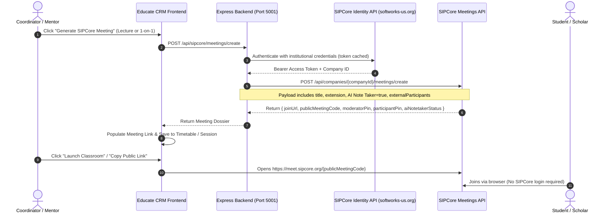

# 🚀 SIPCore Public Meetings & AI Note Taker Integration Plan

This technical design document outlines the end-to-end integration of the **SIPCore Public Meetings API** (`https://softworks-us.org` / `https://meet.sipcore.org`) into the Educate CRM ecosystem.

---

## 🎯 Goal & Business Objective

Enable academic coordinators, faculty mentors, and administrators to seamlessly generate, schedule, and launch enterprise-grade virtual classrooms and 1-on-1 coaching sessions powered by SIPCore. Meetings are hosted entirely on SIPCore infrastructure with shareable public URLs (`https://meet.sipcore.org/{publicMeetingCode}`), eliminating the need for custom WebRTC media infrastructure while unlocking automated **SIPCore AI Note Taker** transcripts and session summaries.

---

## 🏗️ System Architecture & Data Flow



---

## 🔑 Key Architectural Decisions (Aligned via Discovery)

1. **Centralized Institutional Account with Optional Mentor Extension Override**:
   - Institution stores its primary SIPCore account email, password, company ID, and default creator extension in CRM Settings (`db.settings.sipcore`).
   - Mentors and staff can optionally specify their personal SIPCore extension in their profile. If omitted, the system falls back to the institution's default extension.
2. **Server-Side Token Caching & Safety**:
   - The frontend never handles SIPCore passwords or master API tokens.
   - The Express backend handles authentication, token caching, automatic refresh, and request signing.
3. **Smart Toggle with AI Defaults**:
   - `enableAiNotetaker: true` by default for lecture and mentoring classes.
   - Mentors can toggle AI Note Taker and Recording on/off per session.
4. **Focused Window Launch + Copy Link Pill**:
   - Meetings launch in a dedicated high-performance browser tab (`https://meet.sipcore.org/...`).
   - The CRM UI provides 1-click "Copy Public Link" buttons and WhatsApp/Email distribution helpers.

---

## 📦 Proposed Changes by Component

### 1. Data Models & Typings (`src/types/crm.ts`)
#### [MODIFY] `src/types/crm.ts`
- Add `SipcoreSettings` interface:
  ```typescript
  export interface SipcoreSettings {
    enabled: boolean;
    apiBaseUrl: string; // "https://softworks-us.org"
    webMeetBaseUrl: string; // "https://meet.sipcore.org"
    email: string;
    password?: string;
    companyId?: number;
    defaultCreatorExtension: string;
    enableAiNotetakerDefault: boolean;
    isRecordedDefault: boolean;
    allowGuestJoinDefault: boolean;
    requireGuestApprovalDefault: boolean;
    autoDeleteAfterEndDefault: boolean;
  }
  ```
- Extend `OrganizationSettings` with `sipcore?: SipcoreSettings`.
- Extend `Mentor` and `StaffUser` with `sipcoreExtension?: string`.
- Extend `TimetableSlot` and `MentorshipSession` with:
  ```typescript
  sipcoreMeetingId?: string;
  publicMeetingCode?: string;
  joinUrl?: string;
  moderatorPin?: string;
  participantPin?: string;
  enableAiNotetaker?: boolean;
  aiNotetakerStatus?: string;
  hasAiReport?: boolean;
  isRecorded?: boolean;
  ```

---

### 2. Backend Proxy & Token Management (`server/server.ts`)
#### [MODIFY] `server/server.ts`
- Implement SIPCore token manager:
  ```typescript
  let sipcoreTokenCache: { token: string; expiresAt: number; companyId: number } | null = null;
  async function getSipcoreAuth(): Promise<{ token: string; companyId: number }>
  ```
- Add REST endpoints:
  - `POST /api/sipcore/test-connection`: Verifies email/password against `https://softworks-us.org/api/v1/auth/login` and discovers `companyId`.
  - `POST /api/sipcore/meetings/create`:
    - Extracts `createdByExtension` (from payload or defaults).
    - Formats scheduled timestamps to Nigeria Local Time (WAT, UTC+1).
    - Calls `POST /api/companies/{companyId}/meetings/create`.
    - Returns sanitized public data including `joinUrl`, `publicMeetingCode`, PINs, and AI Note Taker status.
  - `GET /api/sipcore/meetings/:meetingId`: Retrieves meeting status and checks `hasAiReport`.
  - `GET /api/sipcore/meetings`: Lists company meetings for audit logging.

---

### 3. CRM Settings Integration Tab (`src/pages/SettingsPage.tsx`)
#### [MODIFY] `src/pages/SettingsPage.tsx`
- Add **SIPCore Virtual Meetings** configuration card:
  - Enable/Disable toggle.
  - API Base URL (`https://softworks-us.org`).
  - Company Email & Password inputs.
  - Company ID (auto-populated upon testing).
  - Default Creator Extension (e.g. `4102`).
  - Default AI Note Taker toggle.
  - **"Test Connection & Verify Company"** action button with live connection diagnostics.

---

### 4. Timetable Lecture Scheduling (`src/components/modals/ScheduleClassModal.tsx` & `TimetablePage.tsx`)
#### [MODIFY] `src/components/modals/ScheduleClassModal.tsx`
- Add a **"Generate SIPCore Virtual Classroom"** button:
  - Automatically provisions a scheduled SIPCore meeting using the class topic, date, start/end time.
  - Sets `venue` to `SIPCore Virtual Classroom` and fills `meetingLink` with `https://meet.sipcore.org/{code}`.
  - Exposes quick toggles: `Enable AI Note Taker` (default ON) and `Record Meeting` (default OFF).
#### [MODIFY] `src/pages/TimetablePage.tsx`
- Enhance slot cards:
  - "Join SIPCore Classroom" button (launches `joinUrl`).
  - "Copy Join Link" button with toast notification.
  - "AI Note Taker Enabled" badge.

---

### 5. 1-on-1 Mentorship Booking (`src/components/modals/BookSessionModal.tsx`)
#### [MODIFY] `src/components/modals/BookSessionModal.tsx`
- Add a **"Create SIPCore 1-on-1 Coaching Room"** toggle:
  - Automatically includes the student as an external participant:
    ```json
    "externalParticipants": [{ "name": currentStudent.name, "email": currentStudent.email }]
    ```
  - Provisions the meeting and stores `joinUrl` in the session record.

---

### 6. Global Header Quick-Meeting Launcher (`TopNavbar.tsx` & `InstantMeetingModal.tsx`)
#### [NEW] `src/components/modals/InstantMeetingModal.tsx`
- Fast modal to generate an instant ad-hoc SIPCore meeting:
  - Meeting Topic (default: "Nexus Faculty Quick Sync").
  - Instant Join URL preview with 1-click Copy.
  - Direct WhatsApp / Email invite button.
  - "Start & Join Now" action button.
#### [MODIFY] `src/components/layout/TopNavbar.tsx`
- Add a prominent video camera icon (`videocam`) in the top navigation bar:
  - Label: "Instant Meeting".
  - Opens `InstantMeetingModal`.

---

## 🛡️ Verification & Safety Protocol

1. **Local-First Development**:
   - All code will be developed and verified locally on `localhost:5173` and `localhost:5001`.
   - `npm run build` must complete with zero TypeScript or bundling errors.
2. **Pre-Deployment Safety Snapshot**:
   - Run `node scripts/backup-and-log.js` before deploying to the production server.
   - Record snapshot in `RESTORATION_LOG.md` with guaranteed 1-line rollback command.
3. **Automated & Manual Verification**:
   - Test SIPCore authentication and company identity resolution.
   - Create a test instant meeting and verify `https://meet.sipcore.org/{code}` loads.
   - Create a scheduled timetable lecture and verify AI Note Taker flag.
   - Create a 1-on-1 mentorship session and verify student external participant pass-through.
   - Verify guest access without SIPCore login in an incognito browser window.
